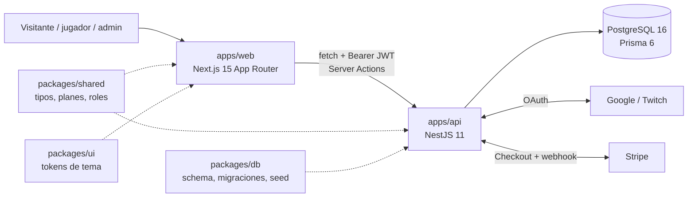

<div align="center">
  <h1>Blazon</h1>
  <p><b>Sistema operativo para organizaciones de esports: sitio público, torneos y suscripciones en un SaaS multi-tenant</b><br/>Piloto con la organización de torneos Lengüetazo Divino (LD), con League of Legends como primer juego</p>

  
  
  
  
  
  
  
  <a href="LICENSE"></a>

  <p>
    <a href="docs/architecture.md">Arquitectura</a> ·
    <a href="docs/roadmap.md">Roadmap</a> ·
    <a href="docs/competitive-matrix.md">Matriz competitiva</a> ·
    <a href="docs/getting-started.md">Guía de arranque</a>
  </p>
</div>

<details>
<summary><b>English summary</b></summary>

Blazon is a multi-tenant SaaS meant to be the operating system of competitive esports organizations: each organization gets a themed public site with block-based pages, a tournament engine (registration, check-in, single-elimination brackets, results), an admin dashboard and a Stripe subscription. It is a pnpm + Turborepo monorepo with a Next.js 15 web app, a NestJS 11 API and PostgreSQL through Prisma 6. Phase 1 (the MVP for the pilot organization Lengüetazo Divino) is implemented and runs locally; deployment, recruitment, fan memberships and the rest of the roadmap are planned for later phases.

</details>

## Qué es

Una organización de esports pequeña o mediana suele operar con seis a diez herramientas sueltas: Discord para la comunidad, hojas de cálculo para los equipos, Challonge o Battlefy para los brackets, una tienda aparte y, muchas veces, ningún sitio web propio. Blazon apunta a reunir eso en un solo producto: cada organización (tenant) tiene su sitio público con su identidad visual, gestiona ahí sus torneos y administra todo desde un panel.

El primer cliente es **Lengüetazo Divino (LD)**, una organización de torneos de League of Legends. Su brief de diseño (fondo negro, rojo vibrante, amarillo neón, tipografía sans gruesa y páginas de Inicio, Torneos, Ranking, Academia, Streaming, Clips y Tienda) definió el tema por defecto y la estructura del sitio piloto, publicado en `/o/ld`. El brief original está en [`docs/pilot-ld/`](docs/pilot-ld/) y el análisis de mercado frente a Battlefy, Toornament, Curry.gg, Enkelt, b.stage y otros, en [`docs/competitive-matrix.md`](docs/competitive-matrix.md).

## Funcionalidades

**Implementado (Fase 1, MVP del piloto LD)**

| Módulo | Qué hace |
| --- | --- |
| Multi-tenant | Organizaciones con slug, tema propio y membresías con roles (`ORG_OWNER`, `ORG_ADMIN`, `ORG_STAFF`, `PLAYER`, `COACH`, `ANALYST`, `FAN`). Las organizaciones se crean por API (`POST /orgs`). |
| Sitio público | Rutas `/o/[org]` con el tema de la organización inyectado como variables CSS y páginas armadas por bloques: `HERO_COUNTDOWN`, `CTA_BUTTONS`, `MISSION`, `CLIPS_GRID`, `TOURNAMENT_LIST`, `RICH_TEXT`. |
| Autenticación | OAuth con Google y Twitch gestionado por el API, JWT en cookie `httpOnly` y login de desarrollo por correo (`ALLOW_DEV_LOGIN`). |
| Torneos | Creación desde el panel (la edición está expuesta en el API), inscripción con nombre de equipo y cupo máximo, check-in, bracket de eliminación simple con sembrado aleatorio y byes resueltos automáticamente, carga de resultados que avanza al ganador y cuenta regresiva al próximo torneo. |
| Panel de la organización | Tema, activación de páginas, torneos (incluida la administración del bracket), miembros y suscripción. |
| Panel personal | Organizaciones que administra el usuario y torneos en los que está inscrito. |
| Suscripciones | Planes Starter, Pro, Elite y Network+ definidos en `@blazon/shared` y sembrados en la base; checkout de Stripe en modo test para los planes de pago, activación directa del plan gratuito y webhook que activa o cancela la suscripción. LD usa un plan Elite cortesía (`COMPED`). |

**Planeado** (ver [`docs/roadmap.md`](docs/roadmap.md)): despliegue con staging (pendiente de la Fase 1), torneos multi-etapa y discovery, rankings y academia (Fase 2), reclutamiento, fans, membresías y tienda (Fase 3), operación de rosters y mercado de scrims (Fase 4) y asistentes de IA y más juegos (Fase 5). En el sitio piloto, las páginas Ranking, Academia, Streaming, Clips, Tienda y Reclutamiento existen como bloques de texto a la espera de esos módulos. Los límites de cada plan (`PLAN_DEFS`) están definidos pero todavía no se aplican en el API.

## Arquitectura



- **Monorepo + monolito modular.** Dos desplegables (`web` y `api`) que comparten tipos, DTOs, roles y planes desde `packages/shared`. El API está dividido en módulos de dominio (`Auth`, `Organizations`, `Tournaments`, `Billing`) que pueden extraerse a servicios propios si la carga lo justifica. Se descartaron el polyrepo y los microservicios desde el día uno.
- **Multi-tenancy con base compartida.** Las tablas de tenant llevan `organizationId` y el control de acceso se hace en los servicios (`assertOrgAdmin`). El enrutamiento público es por ruta (`/o/[slug]`); los dominios propios quedan para la Fase 4.
- **Independiente del juego.** `Game` y `GameAccount` existen desde el primer esquema; League of Legends es el primer título sembrado, no una dependencia del modelo.
- **Sesión en el servidor.** El API emite el JWT tras el OAuth; Next.js lo guarda en una cookie `httpOnly` y las Server Actions lo envían al API como `Authorization: Bearer`.
- **Temas como datos.** Los colores, la fuente, el logo y el hero de cada organización viven en `OrganizationTheme` y se convierten en variables CSS en el layout público.

Más detalle y plan de despliegue por fases en [`docs/architecture.md`](docs/architecture.md).

## Stack tecnológico

| Capa | Tecnología |
| --- | --- |
| Monorepo | pnpm 11 (workspaces), Turborepo 2, TypeScript 5.8 |
| Web | Next.js 15 (App Router, Server Actions), React 19, Tailwind CSS 4 |
| API | NestJS 11, `@nestjs/jwt`, `class-validator` |
| Datos | PostgreSQL 16 (Docker en local), Prisma 6 |
| Pagos | Stripe 18 (Checkout por suscripción y webhooks) |
| Autenticación | OAuth 2.0 de Google y Twitch |

## Puesta en marcha

Requisitos: Node.js 22 o superior, pnpm 11 y Docker (para PostgreSQL).

```bash
pnpm install
cp .env.example .env
pnpm db:up        # PostgreSQL 16 en Docker
pnpm db:migrate   # prisma migrate dev
pnpm db:seed      # piloto LD: organización, tema, páginas, torneo demo y admin
pnpm dev          # web en :3000 y API en :4000
```

Prisma lee `DATABASE_URL` desde `packages/db/.env` y la web lee `NEXT_PUBLIC_API_URL`, `API_URL` y `ALLOW_DEV_LOGIN` desde `apps/web/.env.local`; la [guía de arranque](docs/getting-started.md) explica qué poner en cada archivo.

Variables de entorno (los nombres están en `.env.example`):

| Variable | Uso |
| --- | --- |
| `DATABASE_URL` | Conexión a PostgreSQL |
| `API_PORT`, `API_URL`, `WEB_URL` | Puertos y URLs del API y la web (CORS y redirecciones) |
| `JWT_SECRET` | Firma de los JWT de sesión |
| `ALLOW_DEV_LOGIN` | `true` solo en local: habilita el login por correo sin OAuth |
| `GOOGLE_CLIENT_ID`, `GOOGLE_CLIENT_SECRET` | OAuth de Google (opcional en local) |
| `TWITCH_CLIENT_ID`, `TWITCH_CLIENT_SECRET` | OAuth de Twitch (opcional en local) |
| `STRIPE_SECRET_KEY`, `STRIPE_WEBHOOK_SECRET` | Stripe en modo test (opcional; sin clave, el checkout responde con un error controlado) |
| `NEXT_PUBLIC_API_URL` | URL del API para la web |

Con el login de desarrollo activo, el seed crea una cuenta administradora de LD cuyo correo está en la guía de arranque; cualquier otro correo crea un usuario normal que puede inscribirse en torneos.

URLs locales útiles:

| Qué | URL |
| --- | --- |
| Landing de Blazon | `http://localhost:3000` |
| Sitio público LD | `http://localhost:3000/o/ld` |
| Panel de LD | `http://localhost:3000/dashboard/ld` |
| API | `http://localhost:4000` |

Otros comandos:

```bash
pnpm build                        # build de todo el monorepo
pnpm lint                         # comprobación de tipos (tsc --noEmit) en cada paquete
pnpm db:generate                  # regenerar Prisma Client
pnpm --filter @blazon/api dev     # solo el API
pnpm --filter @blazon/web dev     # solo la web
```

## Despliegue

Todavía no hay configuración de despliegue en el repositorio. El plan de la Fase 1 es Render (servicio `web`, servicio `api` y PostgreSQL gestionado, con staging separado); las fases siguientes contemplan mover el frontend a un CDN y el API a contenedores. Antes de producción hay que definir `JWT_SECRET` y `STRIPE_WEBHOOK_SECRET` y desactivar `ALLOW_DEV_LOGIN`.

## Estructura del repositorio

```
apps/
  web/            Next.js: landing, sitios públicos /o/[org], login, paneles
  api/            NestJS: módulos auth, organizations, tournaments, billing
packages/
  db/             Esquema Prisma, migraciones y seed del piloto LD
  shared/         Roles, planes, tipos de bloques, temas y DTOs compartidos
  ui/             Tokens de tema como variables CSS
docs/             Arquitectura, roadmap, matriz competitiva, guía, brief LD
docker-compose.yml  PostgreSQL 16 para desarrollo
turbo.json        Pipeline de build, dev y lint
```

## Autoría

<table>
  <tr>
    <td align="center"><a href="https://github.com/Joan-Mora"><br/><b>Darwin Joan Aveiga Mora</b></a><br/><sub>Producto, arquitectura y desarrollo full stack</sub></td>
  </tr>
</table>

Piloto desarrollado con la organización Lengüetazo Divino.

## Licencia

Copyright © 2026 Darwin Joan Aveiga Mora. **Todos los derechos reservados.**

Este repositorio es público para que el código pueda consultarse como parte de mi portafolio. Eso no concede permiso para copiarlo, reutilizarlo, modificarlo, distribuirlo ni presentarlo como trabajo propio. Los términos completos están en [`LICENSE`](LICENSE). Para cualquier uso, escribe a [darwin@abacore.co](mailto:darwin@abacore.co).

El nombre y la marca Lengüetazo Divino pertenecen a esa organización. League of Legends es una marca de Riot Games.

<div align="center">
<sub>Hecho por <a href="https://github.com/Joan-Mora">Darwin Aveiga</a> · <a href="https://abacore.co">Abacore S.A.S.</a></sub>
</div>
